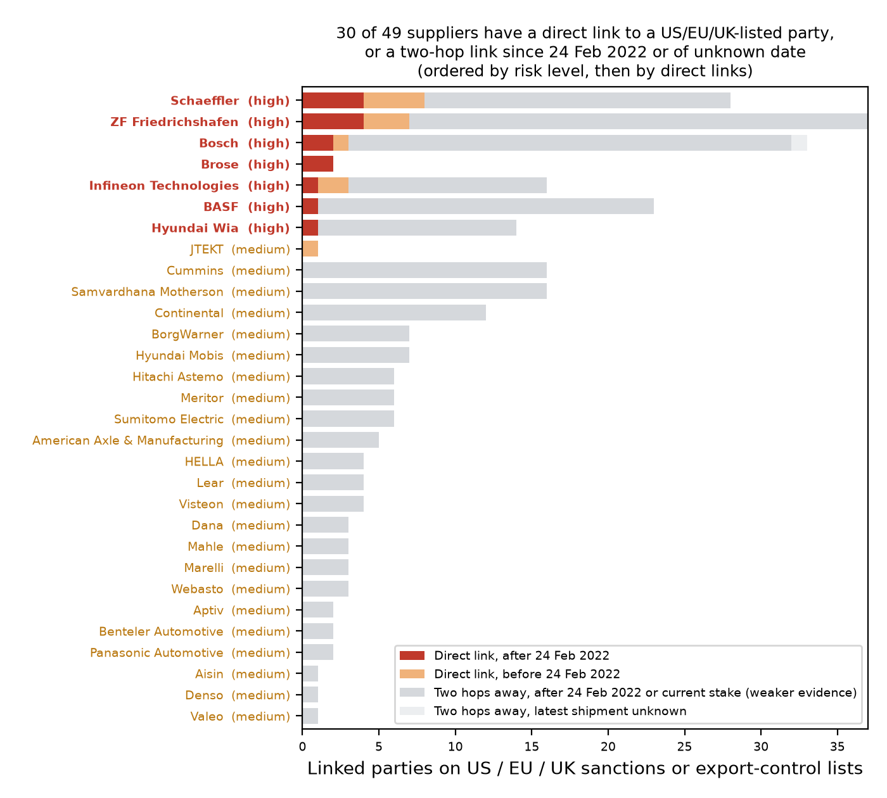

# Hidden risk in an automotive supplier base
**A proof of concept on Sayari's API for a carmaker's procurement and compliance team** · Conner Giovenco · November 2026

## The client's question
"We buy from 49 tier-1 suppliers. None of them is sanctioned. Is any of them still doing business with parties that our US, EU or UK sanctions obligations cover, through who owns them, who they own, or who they trade with?"

## What Sayari shows
**Short answer: four sets of shipments need checking first, all by German companies.** Sayari's shipment records show:

1. **ZF → KAMAZ:** 3 gearbox shipments and a switch arrived after the EU banned transactions with KAMAZ (16 Mar 2022). The last, 16 Jun 2022 (2.8 t of gearboxes), came after the wind-down for older contracts ended (15 May) and after the EU froze KAMAZ's assets (3 Jun).
2. **Mahle → KAMAZ:** a shipment from its subsidiary Mahle Behr arrived on 7 Apr 2022, three weeks after the ban; possibly within the wind-down.
3. **Cummins/Meritor → Ozkaya (Turkey):** two shipments of axle parts from Meritor Germany arrived on 5 Jan 2024, 24 days after the US sanctioned Ozkaya.
4. **Schaeffler → AvtoVAZ:** 3 shipments in Oct–Nov 2023, after the US sanctioned AvtoVAZ (14 Sep 2023), during the US wind-down period (to 13 Dec 2023); the EU listed AvtoVAZ only in 2025.

**Beyond these, 7 of 49 suppliers traded directly after Russia's full-scale invasion (24 Feb 2022) with companies the US, EU or UK restricted later**: 12 more trades, all before the restriction. These are **early warnings**; a name screen clears all seven. (Goods-based export bans are out of scope.)

| Supplier | Sayari's shipments to/from (count) | Latest shipment | First trade restriction |
|---|---|---|---|
| **ZF** | **to KAMAZ** (147), Russian truck maker | **16 Jun 2022** | **EU ban 16 Mar 2022: 4 after** |
| | **to Metrovagonmash** (94), Russian rail-car maker | 2 Mar 2022 | US 19 May 2023 |
| | **to AvtoVAZ** (35), Russian carmaker | 8 May 2022 | US 14 Sep 2023 |
| | **to/from ZF Kama** (5,000+), ZF–KAMAZ joint venture, Russia | 13 Dec 2022 | EU asset freeze 12 Oct 2026 |
| **Schaeffler** | **to AvtoVAZ** (313) | **7 Nov 2023** | **US 14 Sep 2023: 3 after** |
| | **to UAZ** (1), Russian vehicle maker | 30 Mar 2022 | EU asset freeze 3 Jun 2022 |
| | **to Ulyanovsk Machine Tool Plant** (14), Russia¹ | 10 Mar 2022 | EU asset freeze 18 Jul 2025 |
| | Vitesco Mexico **from Yangzhou Yangjie** (2), China² | 18 Jun 2024 | EU asset freeze 23 Apr 2026 |
| **Bosch** | **to ZapchastTrade** (967), Kazakhstan | 3 Sep 2024 | UK 7 Nov 2024 |
| **Brose** | **to NAMI** (1), Russian state auto institute | 20 Jan 2023 | US 23 Feb 2024 |
| | **to Aurus** (1), Russian vehicle maker | 20 Apr 2022 | US 23 Feb 2024 |
| **BASF** | surfactants **to İlmor Kimya** (1), Turkey | 28 Oct 2023 | EU export restriction 20 Jul 2025 |
| **Infineon** | **to Compel** (63), Russian electronics distributor | 1 Mar 2022 | US 20 Jul 2023 |
| **Hyundai Wia** | **to ATM Grupp** (25), Russian machine-tool firm | 2 Jul 2022 | US 23 Feb 2024 |

Dates are customs dates: dispatch if recorded, else arrival. US = OFAC SDN list; UK = UK sanctions list. ¹ Matched by name. ² Vitesco joined Schaeffler in Oct 2024. Robert Bosch Samara (Bosch traded with it to Feb 2023) is also US-listed: renamed NAMI Innovative Components after state-owned NAMI bought it in June 2023, it joined the SDN list on 23 Feb 2024, a year after Bosch's last shipment. A name search for "Bosch" misses it; Sayari's record links the two names.

**Next steps for the compliance team:** (1) ask ZF and Mahle for the contract dates and any authorisation behind their KAMAZ shipments, Cummins/Meritor about Ozkaya, and Schaeffler about any US link to its late-2023 AvtoVAZ shipments; (2) check whether the other relationships continued after each listing. Dates, sources and Sayari IDs for all 40 trades checked: `data/designation_dates.tsv`.

**All 49 suppliers at a glance** (the four cases above come first, whatever their level). A *hop* = one step (owner, subsidiary, buyer or seller); *listed* = on a US, EU or UK list today.

| Level | Suppliers | Why |
|---|---|---|
| **High** | **7** | Direct trade after 24 Feb 2022 with a now-listed party, mostly pre-listing: an early warning, not a breach |
| **Medium** | **26** | **22** linked at two hops after the invasion (incl. Mahle, Cummins and Meritor); **1** traded directly only before it (JTEKT); **3** with only a forced-labor flag (Adient, ThyssenKrupp, Toyoda Gosei) |
| **Low** | **16** | No rule triggered; for **5** the matched Sayari records hold little data, so "low" means "unknown," not "clean" |

In all, **30 of 49 suppliers** appear in the appendix. Most two-hop chains run through another company's trade (weak evidence); stronger ones run through **the supplier's own subsidiary**: at least 10 suppliers have one that traded with a now-listed party after the invasion (25 trades: 20 before the listing; Mahle's and Meritor's after; 2 to YaMZ, whose parent GAZ has been US-sanctioned since 2018; 1 probable false match). One ownership chain Sayari shows as current also counts: BASF → Wintershall Dea → Achim Development.

## Approach
1. **Match** each supplier to every Sayari record with its exact legal name (`/v1/resolution`, `/v1/entity_summary`).
2. **Pull** risk flags, ownership and trade paths (not ended) within two hops to listed parties (`/v1/watchlist`), individual shipment dates for direct and subsidiary trades (`/v1/trade/search/shipments`), and direct shippers (`/v1/supply_chain/upstream`).
3. **Score** with my own triage rules (screening, not a legal finding), auditable by a compliance officer: **high** = a current direct ownership link, or direct trade dated after 24 Feb 2022, with a party now on a US/EU/UK list; **medium** = an older or undated direct link, a two-hop link since then or of unknown date, or a high/critical export-control flag within 2 hops or forced-labor flag within 3; **low** = none of these.
4. **Check by hand** when the counterparty in each post-invasion direct or subsidiary trade was listed (40 trades; official US, EU and UK sources).

## Assumptions
- Only **US, EU and UK** sanctions and export-control lists count (the client operates there). A link must run **one way** (up or down ownership, or along trade) or go **down to a subsidiary and then trade**; shared investors, suppliers or customers don't count. A chain is as recent as its **least recent trade link** (each link dated by its latest shipment); only **high/critical** flags count. Full rules: README.

## Challenges and how they were handled
- **Matching:** Sayari's top "strong" match was sometimes the wrong company (Bosch → Bosch Vietnam). Legal names plus a legal-form check fixed it; the 19 weaker matches were **checked by hand** (2 corrected; see README).
- **The first scoring overstated risk:** 14 "high" suppliers, cut to 3 by three compliance questions: *Is that really their owner?* (shared investors removed); *Is that list binding on us?* (Chinese/Russian counter-sanctions removed); *When did it happen?* (trade before 24 Feb 2022 separated).
- **Dates changed the headline three times.** One of BASF's split records held the İlmor shipment (4 high). Dating trades by their latest shipment, not the first, added ZF, Infineon and Hyundai Wia (7). Then the shipment search, which dates every shipment, showed what the summary missed: ZF's KAMAZ deliveries ran to June 2022, Schaeffler's AvtoVAZ ones to Nov 2023, Meritor's Ozkaya ones to Jan 2024.

## Why this needs Sayari
A name screen of these 49 suppliers finds nothing. Sayari's shipment-level trade data, ownership graph and per-list tags found ZF's gearboxes reaching KAMAZ after the EU ban, post-restriction shipments by two subsidiaries (it takes ownership to reach them), and 7 suppliers trading with companies before regulators acted.

## What I'd do next
- **Score on listing dates, not the invasion date** (done by hand here for 40 trades), **monitor** with Sayari's alerts, and **confirm the matches** with the client's vendor master.
- **Go deeper:** tier-2/3 suppliers, negative news, labor risk (5 suppliers have a shipper flagged for forced labor).

<h2 class="appendix">Appendix: the 30 suppliers with a direct or recent link</h2>

A long grey bar (many two-hop links) is weaker evidence than one red segment. One of Bosch's two post-invasion direct links (red) is Robert Bosch Samara (SDN-listed 23 Feb 2024 under its new name, NAMI Innovative Components; Bosch's last shipment was Feb 2023). Full detail per supplier: `output/supplier_risk.csv`. Every linked party with its closest path, date (and whether the date is observed or a bound), lists and Sayari ID: `output/watchlist_links.csv`. Match evidence: `output/matches.csv`.
